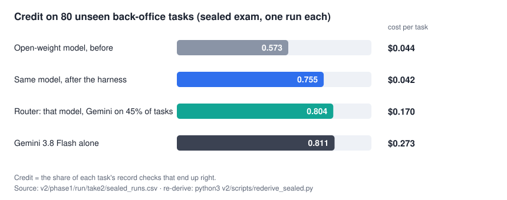
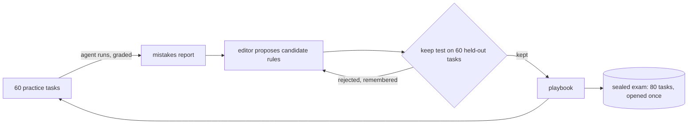

# Harness engineering: a field test

**A harness that taught a cheap open-weight model real back-office work from its own mistakes, tested on tasks it had never seen.**



The work is [Zapier's AutomationBench](https://github.com/zapier/AutomationBench): multi-step tasks across simulated business systems (email, accounting, HR records), graded on whether the company's records end up right. Not a chat benchmark, not one decision: a task is dozens of tool calls, and one wrong write fails it.

## The result

Sealed exam: 80 unseen Finance and HR tasks, one run each, opened once.

| | Credit | Fully passed | Cost per task |
|---|---|---|---|
| Open-weight model (MiniMax M3), before | 0.573 | 23 of 80 | $0.044 |
| **Same model, after the harness** | **0.755** | **33 of 80** | **$0.042** |
| Router: that model, with Gemini on 45% of tasks | 0.804 | 42 of 80 | $0.170 |
| Gemini 3.8 Flash alone | 0.811 | 47 of 80 | $0.273 |

- **It learned.** +0.182 credit on unseen tasks (95% interval +0.095 to +0.272, p < 0.001), with no stronger model in the loop teaching it.
- **It got close for a fraction of the price.** Within about 6 points of Gemini at **15% of the cost per task**.
- **The router held Gemini's credit** (0.804 vs 0.811; difference −0.007, interval −0.061 to +0.053) at 62% of its cost.

The two rules that did the work are the habits diagnosed before any learning started: *do every required write*, and *read the policy emails before any write*.

## The harness

The result is the engineering around the model. Everything in [`v2/src/jevloop`](v2/src/jevloop) was built to make one claim testable: that a cheap model can improve itself, and that we can tell.



- **A learning loop that edits its own rulebook.** The agent reads its own graded mistakes and proposes rules; each rule must beat the current playbook on held-out tasks before it is kept. Rejected rules are shown back to the editor so it stops resubmitting them. [`skill_loop.py`](v2/src/jevloop/skill_loop.py)
- **A checkpoint before every record-changing action.** If the agent has not read the policy emails, the write is held and the agent is told what to read. Replayed over 236 logged runs first, then tested live. [`monitor.py`](v2/src/jevloop/monitor.py), [`masking.py`](v2/src/jevloop/masking.py)
- **Sealed splits and a one-shot exam.** Practice 60, test bench 60, sealed 80, stratified by domain; the sealed set is opened once, guarded in code. [`splits.py`](v2/src/jevloop/splits.py)
- **Hard spend caps, resumable runs.** Paid stages refuse to start without explicit approval, stop at a cap enforced in code, and resume from a cache after rate limits or credit errors without paying twice. [`spend.py`](v2/src/jevloop/spend.py), [`cache.py`](v2/src/jevloop/cache.py)
- **A checker (Jev) that scores runs, and a router built on it.** [`verifier.py`](v2/src/jevloop/verifier.py), [`cascade.py`](v2/src/jevloop/cascade.py)

Design and words: [`docs/HARNESS.md`](docs/HARNESS.md). The full design memo: [`v2/briefs/V2 Phase 1 Canonical Experiment Design.md`](v2/briefs/V2%20Phase%201%20Canonical%20Experiment%20Design.md).

## Why you can check the numbers

- **Preregistered.** Bars were fixed before each test, and every held-out set was opened once. Every deviation is dated in [`v2/PLAN.md`](v2/PLAN.md), including the keep test that was changed after seeing the first attempt (disclosed as post hoc).
- **Noise was measured, not assumed.** Temperature 0 is not repeatable for this model (0 of 10 identical runs), so the harness is built around repeats and margins, not settings.
- **The headline numbers re-derive from a committed table.** No logs, no API key, no network, standard library only:

```bash
python3 v2/scripts/rederive_sealed.py   # 16/16 headline numbers match the published results
```

- **The limits are written down.** [`docs/CLAIMS.md`](docs/CLAIMS.md) says what each result supports and what it does not.

## What did not work, and why it is in here

- **The checker was not a useful router on this task.** Jev's separation of good runs from bad on the exam was AUC 0.566 against a preregistered bar of 0.65. Against sending the same 45% of tasks to Gemini at random, the router gained +0.024 (interval −0.02 to +0.07): the credit came from *how many* tasks went to Gemini, not from choosing well.
- **The checker did not learn.** It improved through redesign (what it sees, questions written per task), not through learning from outcomes.
- **The checkpoint was not needed at exam time.** By then the learned playbook had absorbed the habit; whether the checkpoint was necessary for the learning itself was not tested.
- **A perfect failure detector would be worth about +7 points of credit.** There is real headroom, and it sits in knowing which runs failed.

Two sentences this repo will not say: "MiniMax matches Gemini" (it is 5.6 points behind, interval includes zero) and "the router works" (the share did the work).

## Where this came from: v1

[`v1/`](v1) is the proof of concept: six preregistered experiments on public data, one binary decision each (which headline gets more clicks, which chatbot answer people prefer). It showed that a learned yes/no rubric learns from outcomes when an LLM instruction loop does not, and that routing between the two matched the LLM's accuracy (76.2% vs 76.3%) at 43% of the cost. v2 asked whether that survives contact with real multi-step work. Summary: [`v1/RESULTS.md`](v1/RESULTS.md).

## Follow it and reproduce it

### v2: the field test (start here)

- **What it does.** Teaches a cheap open-weight model (MiniMax M3) to do back-office work from AutomationBench (Finance and HR; 200 tasks split 60 practice, 60 test bench, 80 sealed), graded on whether the simulated company's records end up right. Result: 0.573 to 0.755 credit on the sealed tasks.
- **How it did it.** A five-stage pipeline (`skill`, `jevdata`, `rubric`, `tau`, `sealed`). The learning loop reads the model's graded mistakes, proposes rules, and keeps a rule only if it beats the current playbook on held-out tasks. A checkpoint holds writes until the policy emails are read. A checker scores runs and a router sends the doubtful ones to Gemini. The exam is opened once.
- **Where the code is.** The harness library is [`v2/src/jevloop`](v2/src/jevloop); stages are run by [`v2/scripts/phase1_run.py`](v2/scripts/phase1_run.py) against [`v2/phase1/config_phase1.yaml`](v2/phase1/config_phase1.yaml); task splits are in [`v2/phase1/splits`](v2/phase1/splits).
- **Where the evidence is.** Every number with its source: [`v2/RESULTS.md`](v2/RESULTS.md). Machine-readable outputs: [`v2/phase1/run/take2`](v2/phase1/run/take2) (`skill_final.json` is the learned playbook, `sealed_results.json` the exam, `sealed_runs.csv` the per-run table). The design memo written before the runs: [`v2/briefs/V2 Phase 1 Canonical Experiment Design.md`](v2/briefs/V2%20Phase%201%20Canonical%20Experiment%20Design.md). Every decision and deviation, dated: [`v2/PLAN.md`](v2/PLAN.md).
- **Re-derive it (free, 10 seconds).** `python3 v2/scripts/rederive_sealed.py` recomputes the headline numbers from the committed table, with no API key, using only the standard library.
- **Re-run it (paid, about $118 for all of Phase 1, $42 for the exam alone).** Pin AutomationBench 1.0.6, put `OPENROUTER_KEY` in `v2/.env`, set `run.approved: true` in the config, then run the stages in order. Exact commands: [`docs/REPRODUCE.md`](docs/REPRODUCE.md).

### v1: the proof of concept

- **What it does.** Six preregistered experiments on one binary decision each (which Upworthy headline wins more clicks; which Chatbot Arena answer people prefer), asking whether a learned yes/no rubric (the Jev checker) learns from outcomes when an LLM instruction loop does not. Headline: routing between them matched the LLM, 76.2% vs 76.3%, at 43% of the cost.
- **How it did it.** Two learning loops, each edited one change at a time; an edit is kept only if it beats the current version on a gate set, and the final version is scored once on a sealed set. The verdict rules were written down before running, in [`v1/briefs`](v1/briefs).
- **Where to find it.** Summary and scorecard: [`v1/RESULTS.md`](v1/RESULTS.md). Side-by-side detail: [`v1/experiments/COMPARISON.md`](v1/experiments/COMPARISON.md). Each experiment is an immutable package in [`v1/experiments`](v1/experiments) (report, artifacts, config snapshot, split ids, telemetry). Dated log: [`v1/PLAN.md`](v1/PLAN.md).
- **How to reproduce it.** `cd v1`, install `requirements.txt`, run `pytest` (no API calls). A full re-run needs the raw datasets (not committed; links and licences in [`NOTICE.md`](NOTICE.md), registered split ids in [`v1/data`](v1/data)) and about $78 of API calls. Per-experiment command sequences: [`v1/README.md`](v1/README.md).

## Repo layout

```text
.
├── README.md                    this page
├── NOTICE.md  LICENSE           data sources and licences; what this project is not; MIT
├── docs/
│   ├── HARNESS.md               how the v2 harness works
│   ├── CLAIMS.md                what the results do and do not support
│   ├── REPRODUCE.md             four levels of checking, from reading to re-running
│   └── img/headline.svg         the figure above, generated from the per-run table
├── v2/                          the field test (AutomationBench)
│   ├── README.md  RESULTS.md  PLAN.md  GLOSSARY.md  WHAT_WE_DID_AND_CAN_CLAIM.md  ...
│   ├── src/jevloop/             the harness library
│   ├── scripts/                 stage runner (phase1_run.py), analyses, rederive_sealed.py
│   ├── phase0/                  feasibility: model choice, why Finance and HR
│   ├── phase1/                  config, task splits, pilot/, run/take1, run/take2 (outputs)
│   ├── action_masking/          the checkpoint: replay and live-test reports
│   ├── briefs/                  design briefs written before each stage
│   └── tests/
├── v1/                          the proof of concept (six experiments)
│   ├── README.md  RESULTS.md  PLAN.md
│   ├── *.py  config*.yaml  task*.yaml   the harness, flat: one prep_ / learn_ / sealed_ script per experiment
│   ├── experiments/             six immutable experiment packages + COMPARISON.md
│   ├── data/                    registered split ids only (raw data is not committed)
│   ├── briefs/                  the preregistration briefs
│   └── tests/
└── .github/workflows/tests.yml  CI: re-derive the numbers, run both test suites
```

## Key documents

| | |
|---|---|
| [`v2/README.md`](v2/README.md) | v2 history, results, setbacks, and how to run it |
| [`v2/RESULTS.md`](v2/RESULTS.md) | Every number with its source |
| [`v2/WHAT_WE_DID_AND_CAN_CLAIM.md`](v2/WHAT_WE_DID_AND_CAN_CLAIM.md) | The honest-claims ledger |
| [`v2/PLAN.md`](v2/PLAN.md) | Dated log of every decision, deviation and fix |
| [`v1/RESULTS.md`](v1/RESULTS.md), [`v1/PLAN.md`](v1/PLAN.md) | The same for v1 |
| [`docs/REPRODUCE.md`](docs/REPRODUCE.md) | Four levels of checking, from reading to re-running |
| [`NOTICE.md`](NOTICE.md) | Data sources, licences, and what this project is not |

Total spend across both versions: about $230 in paid model calls (v1 ≈ $78; v2 ≈ $150, of which the sealed exam was ≈ $42).

## About

Independent work by [Alexander Liss](https://aliss77777.github.io/). Not affiliated with Zapier, OpenRouter, MiniMax, Google, or the makers of the Jev model used as the checker; see [`NOTICE.md`](NOTICE.md). Code is MIT-licensed.
