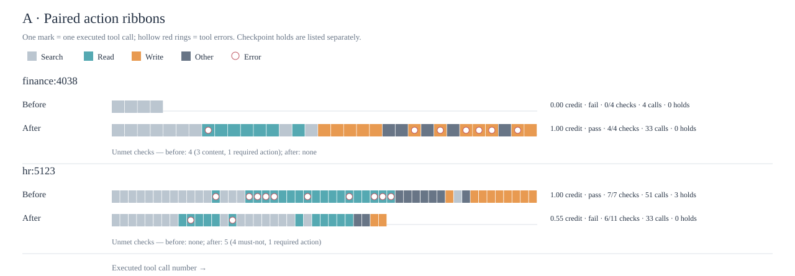
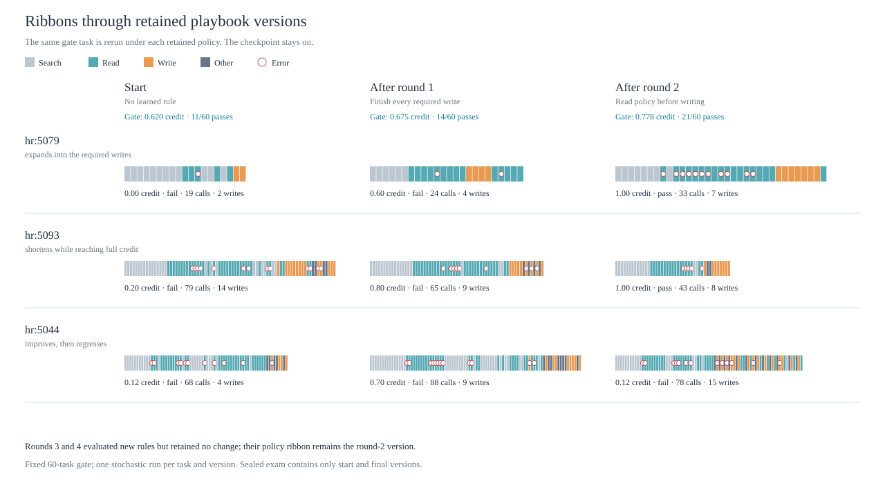
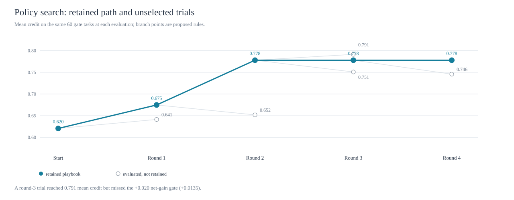
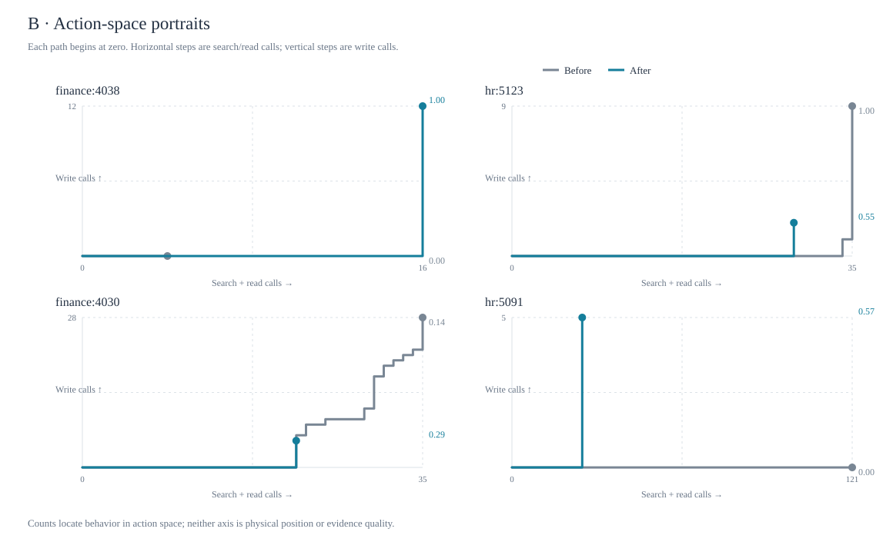
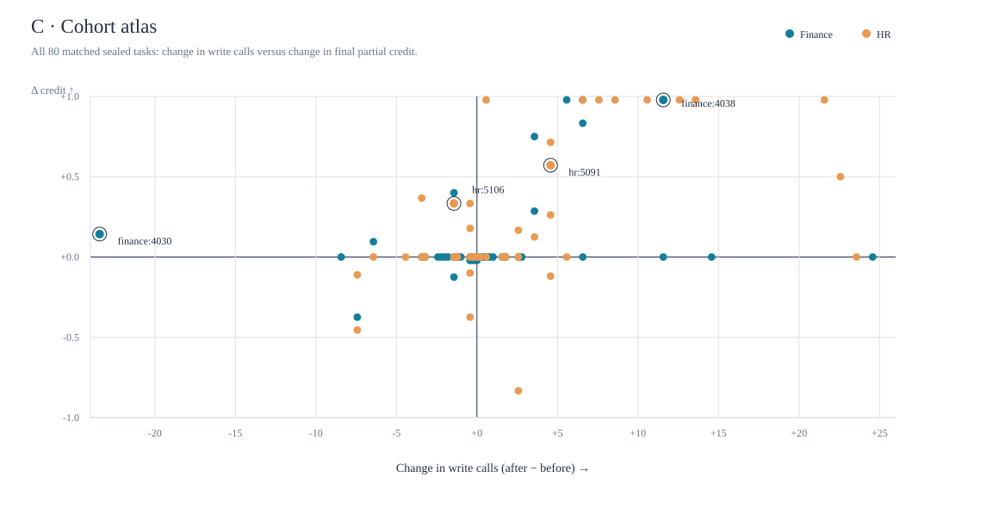

# AutomationBench policy visualization jam

Exploratory figures comparing **MiniMax M3 with the starting playbook** to **the same model with the final learned playbook** on the same 80 sealed Finance and HR tasks. Both conditions used the pre-write checkpoint. These figures are prototypes, not paper-ready evidence of a mechanism.

**Start here:** [Open the six-chapter interactive demo](demo.html). It runs from this folder without a build or network connection and gathers all six figures, the round-by-round story, the topology audit, and its limits in one guided view. Use the on-screen chapters or arrow keys to move through it.

For the complete cohort, open [All 80 paired trajectories](trajectories.html). It groups Finance and HR, reports improved/declined/no-change counts for each, and lets you filter and sort every before/after ribbon. The companion [action-category dataset](trajectories-data.js) contains no prompts or tool contents.

The follow-up analysis of **why improving ribbons grow or shrink** is in [TOPOLOGY_ANALYSIS.md](TOPOLOGY_ANALYSIS.md), with a new [action-mix figure](ribbon-mechanisms.svg) and a same-playbook repeatability check.

## The three concepts

### A. Paired action ribbons



Each mark is a tool call in order: search, read, write, or other (mostly encoding). Red rings identify tool errors. The two opening examples are both improvements: `finance:4038` grows from 4 to 33 calls and 0.00 → 1.00 credit; `hr:5106` shortens from 51 to 45 calls and 0.67 → 1.00 credit. This is the clearest way to show *what the agent actually did*. It can carry call-specific annotations in a later iteration, such as “read policy email” or “write invoice,” once those classifications have been validated. Checkpoint holds are shown as totals because the current run record gives their model step, not a precise position between executed tool calls.

The full atlas keeps the regressions visible. For example, `hr:5123` falls from 1.00 to 0.55 credit; it is no longer an opening example. Its starting run met **7/7** scored checks, while the final-playbook run met **6/11**. Four “must not send” email checks were broken and one required-email check was missed. The denominator changes because a negative check that is satisfied initially is excluded until the run breaks it.

## Extending ribbons through learning rounds

### D. Retained-playbook flipbook



Four learning rounds produced three distinct retained policies: no learned rule, the round-1 rule to complete every required write, and the round-2 rule to read policy emails before writing. Rounds 3 and 4 left the retained playbook unchanged. The fixed 60-task gate has one run per task under each version, so the figure can show matched ribbons through actual policy revisions. The examples intentionally have different shapes: one expands, one compresses, and one improves then regresses. There is no universal “optimal ribbon length.”

The gate set selected the rules, so its progression is a **training and selection trace**, not an independent estimate of generalization. The sealed exam has only starting and final playbook runs; it remains the independent before/after bookend. MiniMax at temperature zero was not perfectly repeatable in this study, so a changed ribbon is not entirely attributable to the text rule on any single task.

### E. Policy-search branches



The retained line and unselected proposals make the trial-and-error structure visible. A round-3 candidate reached 0.791 mean gate credit, above the retained policy's 0.778, but its gain over the parent was only +0.0135, below the chosen +0.020 net-gain threshold, so it was not kept. The margin-based keep test was introduced after the first attempt and disclosed as post hoc in `v2/PLAN.md`; the figure should not call it preregistered or imply that the retained version was a global optimum.

### B. Action-space portraits



This borrows the visual grammar of navigation trajectories without pretending that AutomationBench has physical coordinates. A path moves right for every search or read call and up for every write call. Four matched tasks show different patterns, including a baseline that stayed in repeated reads (`hr:5091`) and a shorter path to full credit (`hr:5106`). The axes measure counts, not the quality of information or correctness of a write. Encoding calls do not move the path.

### C. Cohort atlas



All 80 paired tasks appear in one view. Horizontal position is the change in write-call count; vertical position is the change in final partial credit. Finance and HR use different colors; four example tasks are circled. This checks whether a selected ribbon is typical. It also keeps the exceptions visible: 27 tasks gained credit, 8 lost, and 45 tied. The association between write count and credit change in this one set is positive (Pearson *r* ≈ 0.44), but it is descriptive, not a causal estimate.

## What the logs support

The original full logs are in `/Users/alexanderliss/Documents/jev-test-poc/v2/logs/phase1_run/`. Each candidate-run record includes the ordered tool calls, results, final grade, and checkpoint events. The published repo's `sealed_runs.csv` has only per-run summary fields; it cannot reproduce these action plots on its own.

| Across the 80 matched tasks | Starting | Final |
| --- | ---: | ---: |
| Mean partial credit | 0.573 | 0.755 |
| Fully passed | 23 | 33 |
| Tool calls | 2,960 | 3,030 |
| Search calls | 1,213 | 1,088 |
| Read calls | 1,167 | 1,072 |
| Write calls | 393 | 582 |
| Other calls, mostly encoding | 187 | 288 |
| Tool responses with an `error` object | 380 | 262 |

These are **call counts**, not successful state changes. In particular, a write call may return an error. The logs record chosen actions, not the policy's probability distribution over actions. Partial credit is graded on the final world state; the figures do not assign reward to intermediate actions. The runs are paired by task, while model output remains variable across attempts.

## Recommendation for a paper figure

For the learning story, combine **D** and **E**: the same tasks' ribbons across retained versions, plus the policy-search branches. Pair that with a compact sealed before/after result. For an outcomes-first paper figure, combine **A** and **C**: two contrasting improvements as action ribbons, with the cohort atlas beside or below them. Use **B** as an exploratory or supplemental view; it has the most immediate resemblance to the supplied RL trajectory figure, but its count axes can overstate what we know about the agent's internal policy.

A promising next concept is a **world-state change tapestry**: objects and services on rows, tool-call order on columns, with each confirmed record mutation marked where it happened. That would reveal *which business state changed*, not just how many writes were attempted. It needs careful replay of each call against the pinned AutomationBench simulator; final-state grades alone cannot locate intermediate changes.

The visual direction takes inspiration from the paired, same-episode trajectory comparisons in [LANav](https://arxiv.org/pdf/2607.18794) and [Context-Nav](https://arxiv.org/html/2603.09506v3), while adapting the coordinate system to AutomationBench's discrete tool actions.

## Rebuild

```bash
python3 v2/scripts/explore_policy_visuals.py \
  --logs /Users/alexanderliss/Documents/jev-test-poc/v2/logs/phase1_run
```

The generator reads the local logs and writes only action categories, task IDs, final scores, pass status, and hold counts to the figures and atlas data. It does not copy prompts, tool arguments, tool results, summaries, or hidden assertions into the repo.
