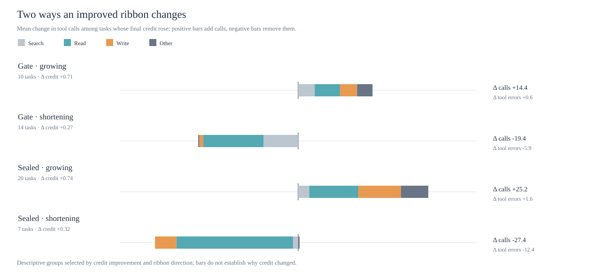

# What makes a learning ribbon grow or shrink?

Exploratory analysis of the existing AutomationBench runs. A ribbon is the ordered sequence of tool calls for one task. “Learning” here means changing the model's retained text playbook after evaluating proposed rules; the model weights did not change.



## The signal in the paths

Among tasks whose partial credit increased, the two directions have different action signatures. The table shows mean **final minus starting** counts per task. The gate set selected the rules; the sealed set was evaluated afterward.

| Set and direction | Tasks | Calls | Search | Read | Write | Tool errors | Consecutive write transitions |
| --- | ---: | ---: | ---: | ---: | ---: | ---: | ---: |
| Gate, growing | 10 | +14.4 | +3.2 | +4.9 | +3.3 | +0.6 | +3.0 |
| Gate, shortening | 14 | −19.4 | −6.7 | −11.6 | −0.8 | −5.9 | −0.1 |
| Sealed, growing | 20 | +25.2 | +2.2 | +9.5 | +8.2 | +1.6 | +5.7 |
| Sealed, shortening | 7 | −27.4 | −1.0 | −22.6 | −4.1 | −12.4 | −1.6 |

One **descriptive** reading: some gains require more work, especially sequences of writes; other gains come with removal of repeated reads and failing calls. In the shortening groups, erroring reads fell by 5.1 per gate task and 11.4 per sealed task on average. In the growing groups, the first write moved roughly 11–12 calls later, consistent with more preparation before a larger write sequence. These averages do not tell us whether a specific read or write caused a grade change. Grouping by both credit gain and length change also makes this a pattern description, not an effect estimate.

Across **all** paired tasks, the final playbook increased average write calls and reduced average reads, searches, and tool errors in both the gate and sealed sets. Total length fell on the gate set (43.2 → 37.8 calls per task) but was nearly flat on the sealed set (37.0 → 37.9). That composition shift is more repeatable than a single direction for ribbon length.

## Does the task predict the direction?

I trained simple classifiers on 59 gate tasks with a nonzero length change and evaluated them on 79 sealed tasks with a nonzero length change. The outcome was whether the final ribbon was longer than the starting ribbon. Inputs available before seeing the final run were: number of required and prohibited checks, number of services in the initial state, count of policy emails, prompt length, and domain. A separate model used prompt word and two-word phrase TF-IDF, echoing the lexical approach in the NLP graph repo.

| Predictor | Sealed AUC | Exploratory bootstrap interval |
| --- | ---: | ---: |
| Coarse task structure | 0.59 | 0.46–0.71 |
| Prompt TF-IDF | 0.57 | 0.44–0.69 |
| Starting ribbon length | 0.86 | 0.77–0.94 |
| Structure plus starting length | 0.83 | 0.72–0.92 |

The tested task structure and prompt language give little reliable discrimination here. Starting length is more predictive, but the target is `final length − starting length`, so this input is mechanically coupled to the outcome. It also reflects a possible regression-to-the-mean effect. It is **not evidence** that a long starting ribbon causes a policy to shorten.

The gate and sealed tasks come from the same benchmark distribution, and the gate influenced policy selection. The bootstrap intervals resample tasks within the sealed set; they do not cover uncertainty from selecting features, selecting a policy, or rerunning the model.

## How much is run variability?

There are two additional runs with the **same final playbook** on each of the 60 gate tasks. The median absolute length difference between those two repeats is 7 calls; the median absolute difference between starting and final playbooks is 11 calls. Relative to the one starting run, only 39 of 60 tasks kept the same grow/shorten/tie direction across all three final-playbook runs. So a single task's ribbon direction is a noisy unit of evidence, even at the configured deterministic temperature.

We have repeats at the final playbook only. To separate playbook effect from run variability for individual tasks, collect several independent runs at **each** retained playbook version, with the same task set and simulator configuration.

## What to borrow from NLP-graph-analysis

The useful transfer is [its graph construction](</Users/alexanderliss/Documents/NLP-graph-analysis/nlp_graph/graph/term_graph.py>): represent observations as a bipartite graph, then inspect repeated connections or communities. Its direct phrase extractor was designed for thousands of B2B posts, with product-specific vocabulary and frequency thresholds; 140 short, structured AutomationBench tasks are a different substrate. The weak prompt TF-IDF result is an additional reason not to make phrase communities the main explanation yet.

A more apt **task topology graph** would connect each task to its required actions, prohibited actions, services, objects, and policy dependencies. A separate **trajectory graph** would retain directed transitions among search, read, write, error, and service nodes, with time order. Measure graph features before examining length direction: required-write depth, cross-service dependencies, policy-before-write dependencies, and prohibited-write density. Then test whether those features interact with playbook version in a paired, repeated-run model. This is a proposed analysis, not a result from the current graph features.

The cleanest next experiment is a crossed design: tasks × retained playbooks × independent repeats, evaluated on tasks outside policy selection. Model ribbon length and credit jointly, with task effects and playbook effects. That can test whether topology predicts the *response to a playbook change* rather than merely describing which runs ended up long.

## Reproduce

The aggregate numbers and chart are generated by `v2/scripts/analyze_ribbon_topology.py` from the local `phase1_run` JSONL logs and pinned task definitions. The machine-readable output is [topology-audit.json](topology-audit.json). No prompts, tool arguments, tool results, or hidden assertions are copied into either output.

```bash
PYTHONPATH=v2/src:v2/scripts \
  /Users/alexanderliss/Documents/jev-test-poc/v2/.venv/bin/python \
  v2/scripts/analyze_ribbon_topology.py \
  --logs /Users/alexanderliss/Documents/jev-test-poc/v2/logs/phase1_run
```
